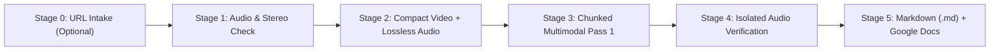

# `video-transcription`

**Turn any video, Loom, or podcast into verified, structured knowledge inside your AI agent.**

Pairs Gemini 4's native video and audio understanding with a multi-pass verification workflow. YouTube talks, Looms, calls, and podcasts become speaker-attributed Markdown and linked Google Docs, ready for people to read and for agents to build from.

Works with **Google Antigravity**, **Claude Code**, **OpenAI Codex**, **Cursor**, and standalone terminals on macOS, Linux, and Windows. Core scripts use the Python 3.10+ standard library only.

```bash
npx skills add osbornec/video-transcription
```

### Try Asking Your Agent

Once installed, prompt your agent naturally:

- *"Turn this Loom (`https://www.loom.com/share/...`) into Verbatim, Clean-Read, and Thematic Markdown with verified product and company spellings so we can draft a spec from it."*
- *"Transcribe this customer discovery recording (`./recordings/customer_call.m4a`) into themed Markdown and publish a Google Doc with working Table of Contents links for the team."*
- *"Transcribe this YouTube panel (`https://www.youtube.com/watch?v=...`) with real speaker names verified on screen and export structured chapters to Markdown."*
- *"Transcribe this podcast from Spotify (`https://open.spotify.com/episode/...`) or Apple Podcasts (`https://podcasts.apple.com/...`) with host and guest labels."*

---

## Why Builders Switch from Auto-Captions & AI Web Chats

| Challenge on Real-World Media | Auto-Captions & AI Web Chats | `video-transcription` |
| :--- | :--- | :--- |
| **Reusable team & agent assets** | Browser chats (NotebookLM, Gemini, ChatGPT) trap summaries inside a one-person tab | Writes structured, agent-readable Markdown and linked Google Docs into your workspace so the whole team and their agents can discover them immediately |
| **High-signal themes & structure** | Raw walls of text or generic summaries that lose verbatim evidence | Pairs verified transcripts with clear themes and chapter summaries so downstream agents start from clean signal |
| **Real speaker names** | Guesses `Speaker 1` and `Speaker 2` from voice alone | Reads speaker tiles, lower-thirds, slides, and spoken introductions so every quote carries the right name |
| **Proper nouns, numbers & fast speech** | Silently invents names and smears fast technical terms | Keeps original speech audio intact and re-checks unclear passages against isolated clips, marking true dropouts honestly |
| **Hour-long calls & crosstalk** | Drops the second half when context fills up, or blurs overlapping voices | Saves long recordings to disk in sequential chunks and separates true multi-mic stereo channels automatically |
| **Coding agents & Google Docs** | Pasted Markdown breaks Google Docs links, and most coding agents lack media viewers | Rebinds native Google Docs heading links, runs natively in Antigravity, and ships a zero-dependency Gemini 4 runner for Claude Code, Codex, Cursor, and CLI |

---

## Pipeline Overview



## How It Works Under the Hood

Every stage is built to preserve spoken accuracy while keeping media small enough for AI agents to inspect reliably:

- **Visual-first compaction without audio loss:** Scales video down to `1 FPS` (`<=480px`, or `>=960px` / `CRF <=28` with `--screen-share` for dense UI demos) while copying original speech audio bit-for-bit (`-c:a copy`, or `128k` AAC for PCM/FLAC). That cuts file size by 85 to 97% (for example, `410.12 MB` down to `9.74 MB` on a 14-minute `1080p` Loom) without smearing `s`, `t`, `k`, `p`, or `f` consonants.
- **Gemini 4 multimodal Pass 1 + disk persistence:** In Google Antigravity, the agent reads chunks natively with `read_file` using your selected Gemini 4 model. Outside Antigravity, [`transcribe_media.py`](./scripts/transcribe_media.py) uploads chunks to the Gemini Files API using Gemini 4 (`--model`, default `gemini-4-neon`). Recordings over `45 MB` or `25 min` split into 20-minute (`1200s`) keyframe-aligned chunks (`-g 10`) flushed to disk after each pass.
- **Targeted `100 Hz to 8 kHz` PCM `.wav` Pass 2 audit:** Every `[unclear]` window is extracted from the **original source media** as a band-pass filtered 16-bit PCM `.wav` clip with `dynaudnorm`. Two-channel streams pass a `-45.0 dB` RMS phase check so `--split-channels` runs only on true panned stereo, avoiding `-65 dB` Zoom/YouTube AAC dither false positives.
- **Native Google Docs anchor binding:** [`fix_gdocs_toc_links.py`](./scripts/fix_gdocs_toc_links.py) imports Markdown via the `gdocs` CLI or Google Drive v3 / Docs v1 REST APIs and rebinds every `#slug` TOC anchor to its live Google Docs `headingId` (`#heading=h.xxx`).

---

## Manual Install & Setup

Use `npx skills add osbornec/video-transcription` above for automatic setup, or install manually into a specific agent folder:

<details>
<summary><strong>macOS &amp; Linux (bash / zsh)</strong></summary>

```bash
git clone https://github.com/osbornec/video-transcription.git video-transcription
cd video-transcription

# Google Antigravity (global)
mkdir -p ~/.gemini/config/skills && cp -R . ~/.gemini/config/skills/video-transcription

# OpenAI Codex (global)
mkdir -p ~/.codex/skills && cp -R . ~/.codex/skills/video-transcription

# Claude Code (global)
mkdir -p ~/.claude/skills && cp -R . ~/.claude/skills/video-transcription

# Project-local discovery (.agents/skills/)
mkdir -p /path/to/project/.agents/skills && cp -R . /path/to/project/.agents/skills/video-transcription
```

</details>

<details>
<summary><strong>Windows (PowerShell)</strong></summary>

```powershell
git clone https://github.com/osbornec/video-transcription.git video-transcription
Set-Location video-transcription

# Google Antigravity (global)
New-Item -ItemType Directory -Force -Path "$HOME\.gemini\config\skills\video-transcription" | Out-Null
Copy-Item -Recurse -Force ".\SKILL.md", ".\scripts", ".\references" "$HOME\.gemini\config\skills\video-transcription\"

# OpenAI Codex (global)
New-Item -ItemType Directory -Force -Path "$HOME\.codex\skills\video-transcription" | Out-Null
Copy-Item -Recurse -Force ".\SKILL.md", ".\scripts", ".\references" "$HOME\.codex\skills\video-transcription\"

# Project-local discovery (.agents/skills/)
New-Item -ItemType Directory -Force -Path "C:\path\to\project\.agents\skills\video-transcription" | Out-Null
Copy-Item -Recurse -Force ".\SKILL.md", ".\scripts", ".\references" "C:\path\to\project\.agents\skills\video-transcription\"
```

</details>

---

## Prerequisites & Agent Compatibility

All Python scripts run on **Python 3.10+ standard library only** (`pip install` is not required for core execution).

| Agent / Runtime | Stages 3 to 4 (Audio + Visual Pass) | Stage 5 Google Docs Publishing *(Optional)* | Stage 5 Markdown Output |
| :--- | :--- | :--- | :--- |
| **Google Antigravity** | Native `read_file` with a Gemini 4 model *(no API key needed)* | Built-in `gdocs` CLI *(zero setup)* | Always included (`.md` only, no `.docx`) |
| **Claude Code / Codex / Cursor / CLI** | [`transcribe_media.py`](./scripts/transcribe_media.py) + `GEMINI_API_KEY` *(defaults to `gemini-4-neon`)* | [`fix_gdocs_toc_links.py`](./scripts/fix_gdocs_toc_links.py) via `gcloud auth` or `GOOGLE_ACCESS_TOKEN` | Always included (zero cloud auth needed) |

### Recommended Models

- **In Google Antigravity:** Select a **Gemini 4** multimodal model in your Antigravity model picker so `read_file` can inspect `.mp4` video frames and `.wav` audio clips natively.
- **Outside Antigravity (`transcribe_media.py`):** Defaults to `gemini-4-neon`; pass `--model <id>` to switch to any other Gemini 4 model ID.

### System Binaries

| Dependency | Needed For | macOS | Windows | Linux (Debian / Ubuntu) |
| :--- | :--- | :--- | :--- | :--- |
| **Python 3.10+** | Running all helper scripts | `brew install python` | `winget install Python.Python.3.12` | `sudo apt install python3` |
| **`ffmpeg` + `ffprobe`** | Compaction & PCM `.wav` extraction | `brew install ffmpeg` | `winget install Gyan.FFmpeg` | `sudo apt install ffmpeg` |
| **`yt-dlp`** *(optional)* | Stage 0 `--url` downloads | `brew install yt-dlp` | `winget install yt-dlp.yt-dlp` | `pip install -U yt-dlp` |
| **`GEMINI_API_KEY`** *(outside Antigravity)* | Joint video/audio Gemini 4 API pass | Export from [Google AI Studio](https://aistudio.google.com/) | `$env:GEMINI_API_KEY = "..."` | Export in shell profile |
| **`gcloud` CLI** *(optional outside Antigravity)* | Exporting to Google Docs via REST | `brew install --cask google-cloud-sdk` | `winget install Google.CloudSDK` | `apt install google-cloud-cli` |
| **`python-docx`** *(optional)* | Comparing an old `.docx` draft in `build_changelog.py` | `pip install python-docx` | `pip install python-docx` | `pip install python-docx` |

---

## CLI Toolkit Reference

*(Use `python3` on macOS/Linux or `python` on Windows.)*

### 1. [`scripts/prepare_compact_video.py`](./scripts/prepare_compact_video.py)
Downloads optional URL sources (YouTube, YouTube Music, Loom, Apple Podcasts, Spotify episode URLs via public RSS, + `.info.json`), audits stereo phase difference, compacts video without upscaling (with `<=720p` download fallback, concurrent HLS fragment fetching, and `--screen-share` support), preserves lossless/128k audio, and splits long outputs into compaction-safe chunks.

| Flag | Default | Description |
| :--- | :--- | :--- |
| `-i`, `--input-path` | `""` | Local source media path (`.mp4`, `.mov`, `.mkv`, `.webm`, `.m4a`, `.mp3`, `.wav`, `.flac`) |
| `-u`, `--url` | `""` | Online video or podcast URL (YouTube, YouTube Music, Loom, Apple Podcasts, Spotify episode) |
| `-o`, `--output-path` | `<stem>_compact_1fps.*` | Target compact media path |
| `--download-dir` | parent of `--output-path` | Directory for raw `--url` downloads and `.info.json` metadata |
| `--concurrent-fragments` | `8` | Concurrent HLS/DASH fragment connections for `yt-dlp` |
| `--audio-only` | `false` | Download/extract audio only without video frames (podcasts & YouTube Music) |
| `--screen-share` | `false` | Screen-share / slide preset (`>=960px` max width, `<=28` CRF for legible UI text) |
| `--width` | `480` | Max width in pixels (never upscales smaller inputs; keeps even width/height) |
| `--fps` | `1` | Compact frame rate for visual speaker diarization |
| `--crf` | `35` | x264 CRF quality factor |
| `--segment-seconds` | `1200` | Segment duration in seconds when split threshold triggers (`0` disables) |
| `--segment-trigger-minutes` | `25.0` | Auto-split outputs exceeding N minutes |
| `--segment-trigger-mb` | `45.0` | Auto-split outputs exceeding N MB |

```bash
python3 scripts/prepare_compact_video.py --input-path "./recordings/panel_session.mp4"
python3 scripts/prepare_compact_video.py --url "https://www.youtube.com/watch?v=VIDEO_ID" -o "./work/session_compact_1fps.mp4"
python3 scripts/prepare_compact_video.py --url "https://www.loom.com/share/VIDEO_ID" --download-dir "./recordings" -o "./work/loom_compact_1fps.mp4"
python3 scripts/prepare_compact_video.py --url "https://podcasts.apple.com/us/podcast/.../id123?i=456"
python3 scripts/prepare_compact_video.py --url "https://open.spotify.com/episode/EPISODE_ID"
python3 scripts/prepare_compact_video.py --url "https://music.youtube.com/watch?v=VIDEO_ID" --audio-only
```

### 2. [`scripts/transcribe_media.py`](./scripts/transcribe_media.py) *(Non-Antigravity Multimodal Helper)*
Uploads compact video segments, audio podcast tracks, or enhanced `.wav` clips to the Gemini Files API (`GEMINI_API_KEY`), automatically adapts prompts for visual video vs. audio-only podcast diarization, and deletes temporary remote uploads on exit.

| Flag | Default | Description |
| :--- | :--- | :--- |
| `-i`, `--input` | *(required)* | One or more `.mp4`, `.mkv`, `.wav`, or `.m4a` paths |
| `-m`, `--mode` | `transcribe` | `transcribe` (Pass 1 visual+audio transcript + low-SNR windows) or `audit-wav` (Pass 2 clip review) |
| `--offset` | `00:00` | Base timestamp offset (`MM:SS` or `HH:MM:SS`) added to segment timestamps |
| `--context` | `""` | Inline notes or `@path/to/context.json` for speaker spellings and chapter markers |
| `-o`, `--output` | stdout | Destination Markdown path (flushed directly to disk) |
| `--model` | `gemini-4-neon` | Gemini model ID (override with any Gemini 4 model ID) |
| `--keep-remote` | `false` | Retain remote file on Gemini Files API instead of deleting after completion |

```bash
python3 scripts/transcribe_media.py -m transcribe -i "./work/session_compact_1fps_part01.mp4" --offset "20:00" --context "@./work/session.info.json" -o "./scratch/verbatim_chunk_02.md"
python3 scripts/transcribe_media.py -m audit-wav -i "./scratch/w01_000410_000435.wav" --context "Check speaker transition near 04:20"
```

### 3. [`scripts/extract_enhanced_clips.py`](./scripts/extract_enhanced_clips.py)
Extracts targeted windows from the **original source media** as uncompressed 16-bit PCM `.wav` clips filtered to human speech frequencies (`100 Hz to 8 kHz`) with `dynaudnorm`.

| Flag | Default | Description |
| :--- | :--- | :--- |
| `-i`, `--input-path` | *(required)* | Original uncompressed/high-quality media source |
| `-o`, `--output-dir` | `.` | Directory for extracted `.wav` clips |
| `-w`, `--windows` | *(required)* | Space- or comma-separated intervals (`04:10-04:35`, `01:02:10-01:02:40`) |
| `--split-channels` | `false` | Export separate `_L.wav` and `_R.wav` mono tracks when `channels >= 2` |

```bash
python3 scripts/extract_enhanced_clips.py -i "./recordings/panel_session.mp4" -o "./scratch" -w "04:10-04:35" "28:30-29:05"
```

### 4. [`scripts/fix_gdocs_toc_links.py`](./scripts/fix_gdocs_toc_links.py) *(Optional Google Docs Exporter)*
Uploads Markdown to Google Docs, resolves imported `headingId` targets, rebinds all broken Table of Contents `#slug` anchors to `#heading=h.xxx`, and creates clickable local `.url` / `.webloc` shortcuts.

| Flag | Default | Description |
| :--- | :--- | :--- |
| `doc_id` | `""` | Existing Google Doc ID (omit when creating a new Doc via `--import-md`) |
| `--import-md` | `""` | Local Markdown file to create or update |
| `--title` | derived | Google Doc title when creating a new Doc |
| `--tab` | `""` | Optional Google Docs tab ID (`t.0`) |
| `--shortcut-dir` | `""` | Folder to write local `.url` / `.webloc` shortcut file(s) |
| `--shortcut-format` | `url` | `url`, `webloc` (macOS Finder plist), `both`, or `auto` |
| `--backend` | `auto` | `auto`, `gdocs` (Antigravity CLI), or `rest` (Google Drive v3 + Docs v1 REST APIs) |

```bash
python3 scripts/fix_gdocs_toc_links.py --import-md "./out/Session_Thematic_Clean_Read_Transcript.md" --title "Session: Thematic Clean-Read" --shortcut-dir "./out" --shortcut-format auto
```

### 5. [`scripts/build_changelog.py`](./scripts/build_changelog.py)
Generates a turn-by-turn Markdown diff changelog comparing a rough/unclear `.md`, `.txt`, or legacy `.docx` draft against the verified `_Perfect_Transcript.md`.

```bash
python3 scripts/build_changelog.py --old "./drafts/initial_draft.md" --new "./out/Session_Perfect_Transcript.md" --output "./out/Transcript_Corrections_Changelog.md"
```

---

## Deliverable Editions

All deliverables use Markdown (`.md`) and optional Google Docs, never `.docx`. See [`examples/sample_outputs.md`](./examples/sample_outputs.md) for side-by-side excerpts and [`references/editorial-style-guide.md`](./references/editorial-style-guide.md) for formatting standards.

| Edition | Pattern | Best Use Case |
| :--- | :--- | :--- |
| **Verbatim Perfect** | `*_Perfect_Transcript.md` | Full spoken record preserving every false start, reaction, and honest VoIP packet-loss tag. |
| **Clean-Read** | `*_Clean_Read_Transcript.md` | Review copy with spoken fillers removed and all facts, voice, and `[MM:SS]` timestamps kept. |
| **Thematic Clean-Read** | `*_Thematic_Clean_Read_Transcript.md` | Structured chapter headings with a clickable Table of Contents and one-sentence summaries. |
| **Verification Changelog** | `Transcript_Corrections_Changelog.md` | Turn-by-turn table logging every resolved `[unclear]` span and speaker fix against an earlier draft. |

---

## Repository Structure

```text
video-transcription/
├── SKILL.md                             # Core 6-stage agent runbook & decision trees
├── README.md                            # Public documentation & CLI reference
├── CHANGELOG.md                         # Release history (Keep a Changelog / SemVer)
├── CONTRIBUTING.md                      # Contribution rules & standard-library policy
├── LICENSE                              # MIT License
├── assets/
│   └── social-preview.svg               # 1280x640 OpenGraph card for GitHub & directory thumbnails
├── scripts/
│   ├── prepare_compact_video.py         # URL fetch, topology audit, lossless compaction & chunking
│   ├── transcribe_media.py              # Gemini 4 API Files/generateContent runner for non-Antigravity agents
│   ├── extract_enhanced_clips.py        # 100 Hz - 8 kHz PCM .wav clip extractor (--split-channels)
│   ├── fix_gdocs_toc_links.py           # Drive/Docs REST & gdocs CLI importer + ToC headingId binder
│   ├── build_changelog.py               # Turn-by-turn verification diff changelog generator
│   ├── prepare_compact_video.ps1        # Legacy Windows PowerShell compaction wrapper
│   └── extract_enhanced_clips.ps1       # Legacy Windows PowerShell clip extractor
├── references/
│   ├── editorial-style-guide.md         # Verbatim/Clean-Read/Thematic rules & heading slug spec
│   └── troubleshooting.md               # Cross-platform ffmpeg, yt-dlp, Gemini & Google OAuth fixes
├── examples/
│   └── sample_outputs.md                # Sample excerpts across all 4 deliverable formats
└── tests/
    └── test_scripts.py                  # Cross-platform unittest suite & hygiene checks
```

---

## Testing & Contributing

```bash
python3 -m unittest discover -s tests -v
```

See [`CONTRIBUTING.md`](./CONTRIBUTING.md) and [`references/troubleshooting.md`](./references/troubleshooting.md).

---

## License

Licensed under the [MIT License](./LICENSE).
