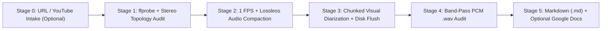

# `video-transcription`

**Transcribe video, audio, YouTube videos, and podcasts (Spotify, Apple Podcasts, YouTube Music) to speaker-diarized Markdown and Google Docs transcripts.**

High-accuracy **video to text** and **audio to text** (speech-to-text) workflow for **Claude Code**, **OpenAI Codex**, **Cursor**, **Google Antigravity**, and standalone terminals across **macOS, Linux, and Windows**—using **zero external Python packages** for core transcription prep and publishing.

```bash
npx skills add osbornec/video-transcription
```

### Try Asking Your Agent

Once installed, prompt your agent naturally:

- *"Create a YouTube transcript from `https://www.youtube.com/watch?v=...` with speaker diarization verified on screen, exported as Verbatim, Clean-Read, and Thematic Markdown."*
- *"Transcribe this podcast from Spotify (`https://open.spotify.com/episode/...`) or Apple Podcasts (`https://podcasts.apple.com/...`) to Markdown with host and guest labels."*
- *"Convert `./recordings/keynote_panel.mp4` video to text, extract enhanced `.wav` audio clips for every `[unclear]` timestamp, and generate a verified transcript."*
- *"Compare `./draft_transcript.md` against `./recordings/interview.m4a`, resolve unclear technical terms, and publish a Thematic Clean-Read Google Doc with working Table of Contents links."*

---

## Standard Transcription vs. `video-transcription`

| Challenge on Real-World Media | Standard Audio-Only / Single-Pass LLMs | `video-transcription` Pipeline |
| :--- | :--- | :--- |
| **Speaker identification** | Guesses `Speaker 1` / `Speaker 2` from voice alone | Compacts video to `1 FPS` (`<=480px`) so agents read lower-thirds, speaker tiles, slides, and mic handoffs |
| **Off-mic & rapid speech** | Re-encoding audio (`32k` AAC) smears consonants and triggers confident hallucinations | Keeps **lossless audio (`-c:a copy`)** and audits flagged windows from **100 Hz – 8 kHz PCM `.wav` clips** |
| **Hour-long webinars (`60–120m`)** | Truncates or triggers silent LLM context compaction mid-file | Auto-splits media `>45 MB` or `>25 min` into `20m` keyframe segments and flushes each chunk to disk |
| **Zoom / YouTube AAC stereo** | Splits fake mono tracks because `-65 dB` L/R codec noise looks non-zero | Uses a calibrated **`-45 dB` RMS phase threshold** (`--split-channels` only for true panned stereo) |
| **Google Docs Table of Contents** | Imported `#slug` Markdown anchors break inside Google Docs | Binds every ToC entry to native Google Docs `headingId` (`#heading=h.xxx`) via `gdocs` CLI or REST |
| **Non-Antigravity agents** | Blocked when Claude Code, Codex, or Cursor lack built-in video/audio readers | Includes [`transcribe_media.py`](./scripts/transcribe_media.py) (Gemini Files API) + pure-REST Google Docs fallback |

---

## Why This Pipeline Exists

Standard audio-only transcription and naive video shrinking fail in four predictable ways on long panels, webinars, and interviews:

1. **Aggressive audio downsampling causes confident hallucinations:** Re-encoding AAC/Opus speech down to `32k` AAC smears high-frequency consonants (`s`, `t`, `k`, `p`, `f`), causing models to invent plausible-sounding idioms instead of off-mic words.
   - **Solution:** Keep **lossless audio bitstreams (`-c:a copy`)** (or `128k` AAC for PCM/FLAC) while cutting video bytes ~85–90% by scaling frames to `<=480px` at `1 FPS` (with a no-upscale guard for 240p/360p inputs). Visual frames remain sharp enough to read lower-thirds, active-speaker borders, and presentation slides.
2. **Hour-long 1 FPS files still trigger silent context compaction:** Even a `~55–65 MB` hour-long 1 FPS `.mp4` that passes a 100 MB file-size check can overflow active token context once `.wav` audit clips are loaded.
   - **Solution:** Auto-segment compact outputs larger than **`45 MB` or `25 minutes`** into **20-minute (`1200s`) keyframe-aligned chunks** (`-g 10`) and flush each chunk's verbatim Markdown to disk before loading the next segment.
3. **Codec noise triggers false stereo splitting:** Conferencing tools and YouTube AAC encoders introduce ~`-65 dB` L/R quantization variance on dual-mono audio, fooling naive `RMS != -inf` checks into treating mono streams as stereo.
   - **Solution:** Treat `RMS diff <= -45.0 dB` (or `-inf`) as dual-mono and reserve `--split-channels` (`_L.wav` / `_R.wav`) for true panned stereo recordings.
4. **Markdown Table of Contents anchors break on Google Drive import, and non-Antigravity agents lack native video/audio viewers:**
   - **Solution ([`fix_gdocs_toc_links.py`](./scripts/fix_gdocs_toc_links.py)):** Imports Markdown cleanly and rebinds every `#slug` link to its native Google Docs `headingId` (`#heading=h.xxx`) via either Antigravity's `gdocs` CLI or direct **Drive v3 + Docs v1 REST APIs**.
   - **Solution ([`transcribe_media.py`](./scripts/transcribe_media.py)):** Lets Claude Code, Codex, and Cursor run the exact same joint visual + audio workflow via the Gemini Files API (`GEMINI_API_KEY`).

---

## Pipeline Architecture



---

## Quick Installation

### Option 1: Skills CLI (`npx skills`)
Works with Claude Code, Cursor, Codex, and other [Agent Skills](https://skills.sh/) compatible agents:

```bash
# Install via Skills CLI
npx skills add osbornec/video-transcription
```

### Option 2: Manual Install

<details>
<summary><strong>macOS &amp; Linux (bash / zsh)</strong></summary>

```bash
git clone https://github.com/osbornec/video-transcription.git video-transcription
cd video-transcription

# Google Antigravity (global)
mkdir -p ~/.gemini/config/skills && cp -R . ~/.gemini/config/skills/video-transcription

# OpenAI Codex (global)
mkdir -p ~/.codex/skills && cp -R . ~/.codex/skills/video-transcription

# Claude Code (global)
mkdir -p ~/.claude/skills && cp -R . ~/.claude/skills/video-transcription

# Project-local discovery (.agents/skills/)
mkdir -p /path/to/project/.agents/skills && cp -R . /path/to/project/.agents/skills/video-transcription
```

</details>

<details>
<summary><strong>Windows (PowerShell)</strong></summary>

```powershell
git clone https://github.com/osbornec/video-transcription.git video-transcription
Set-Location video-transcription

# Google Antigravity (global)
New-Item -ItemType Directory -Force -Path "$HOME\.gemini\config\skills\video-transcription" | Out-Null
Copy-Item -Recurse -Force ".\SKILL.md", ".\scripts", ".\references" "$HOME\.gemini\config\skills\video-transcription\"

# OpenAI Codex (global)
New-Item -ItemType Directory -Force -Path "$HOME\.codex\skills\video-transcription" | Out-Null
Copy-Item -Recurse -Force ".\SKILL.md", ".\scripts", ".\references" "$HOME\.codex\skills\video-transcription\"

# Project-local discovery (.agents/skills/)
New-Item -ItemType Directory -Force -Path "C:\path\to\project\.agents\skills\video-transcription" | Out-Null
Copy-Item -Recurse -Force ".\SKILL.md", ".\scripts", ".\references" "C:\path\to\project\.agents\skills\video-transcription\"
```

</details>

---

## Prerequisites & Agent Compatibility

All Python scripts run on **Python 3.10+ standard library only** (`pip install` is not required for core execution).

| Agent / Runtime | Stages 3–4 (Audio + Visual Pass) | Stage 5 Google Docs Publishing *(Optional)* | Stage 5 Markdown Output |
| :--- | :--- | :--- | :--- |
| **Google Antigravity** | Native `read_file` *(no API key needed)* | Built-in `gdocs` CLI *(zero setup)* | Always included (`.md` only, no `.docx`) |
| **Claude Code / Codex / Cursor / CLI** | [`transcribe_media.py`](./scripts/transcribe_media.py) + `GEMINI_API_KEY` | [`fix_gdocs_toc_links.py`](./scripts/fix_gdocs_toc_links.py) via `gcloud auth` or `GOOGLE_ACCESS_TOKEN` | Always included (zero cloud auth needed) |

### System Binaries

| Dependency | Needed For | macOS | Windows | Linux (Debian / Ubuntu) |
| :--- | :--- | :--- | :--- | :--- |
| **Python 3.10+** | Running all helper scripts | `brew install python` | `winget install Python.Python.3.12` | `sudo apt install python3` |
| **`ffmpeg` + `ffprobe`** | Compaction & PCM `.wav` extraction | `brew install ffmpeg` | `winget install Gyan.FFmpeg` | `sudo apt install ffmpeg` |
| **`yt-dlp`** *(optional)* | Stage 0 `--url` downloads | `brew install yt-dlp` | `winget install yt-dlp.yt-dlp` | `pip install -U yt-dlp` |
| **`GEMINI_API_KEY`** *(outside Antigravity)* | Joint video/audio Gemini API pass | Export from [Google AI Studio](https://aistudio.google.com/) | `$env:GEMINI_API_KEY = "..."` | Export in shell profile |
| **`gcloud` CLI** *(optional outside Antigravity)* | Exporting to Google Docs via REST | `brew install --cask google-cloud-sdk` | `winget install Google.CloudSDK` | `apt install google-cloud-cli` |
| **`python-docx`** *(optional)* | Comparing an old `.docx` draft in `build_changelog.py` | `pip install python-docx` | `pip install python-docx` | `pip install python-docx` |

---

## CLI Toolkit Reference

*(Use `python3` on macOS/Linux or `python` on Windows.)*

### 1. [`scripts/prepare_compact_video.py`](./scripts/prepare_compact_video.py)
Downloads optional URL sources (YouTube, YouTube Music, Apple Podcasts, Spotify episode URLs via public RSS, + `.info.json`), audits stereo phase difference, compacts video without upscaling, preserves lossless/128k audio, and splits long outputs into compaction-safe chunks.

| Flag | Default | Description |
| :--- | :--- | :--- |
| `-i`, `--input-path` | `""` | Local source media path (`.mp4`, `.mov`, `.mkv`, `.webm`, `.m4a`, `.mp3`, `.wav`, `.flac`) |
| `-u`, `--url` | `""` | Online video or podcast URL (YouTube, YouTube Music, Apple Podcasts, Spotify episode) |
| `-o`, `--output-path` | `<stem>_compact_1fps.*` | Target compact media path |
| `--audio-only` | `false` | Download/extract audio only without video frames (podcasts & YouTube Music) |
| `--width` | `480` | Max width in pixels (never upscales smaller inputs; keeps even width/height) |
| `--fps` | `1` | Compact frame rate for visual speaker diarization |
| `--crf` | `35` | x264 CRF quality factor |
| `--segment-seconds` | `1200` | Segment duration in seconds when split threshold triggers (`0` disables) |
| `--segment-trigger-minutes` | `25.0` | Auto-split outputs exceeding N minutes |
| `--segment-trigger-mb` | `45.0` | Auto-split outputs exceeding N MB |

```bash
python3 scripts/prepare_compact_video.py --input-path "./recordings/panel_session.mp4"
python3 scripts/prepare_compact_video.py --url "https://www.youtube.com/watch?v=VIDEO_ID" -o "./work/session_compact_1fps.mp4"
python3 scripts/prepare_compact_video.py --url "https://podcasts.apple.com/us/podcast/.../id123?i=456"
python3 scripts/prepare_compact_video.py --url "https://open.spotify.com/episode/EPISODE_ID"
python3 scripts/prepare_compact_video.py --url "https://music.youtube.com/watch?v=VIDEO_ID" --audio-only
```

### 2. [`scripts/transcribe_media.py`](./scripts/transcribe_media.py) *(Non-Antigravity Multimodal Helper)*
Uploads compact video segments, audio podcast tracks, or enhanced `.wav` clips to the Gemini Files API (`GEMINI_API_KEY`), automatically adapts prompts for visual video vs. audio-only podcast diarization, and deletes temporary remote uploads on exit.

| Flag | Default | Description |
| :--- | :--- | :--- |
| `-i`, `--input` | *(required)* | One or more `.mp4`, `.mkv`, `.wav`, or `.m4a` paths |
| `-m`, `--mode` | `transcribe` | `transcribe` (Pass 1 visual+audio transcript + low-SNR windows) or `audit-wav` (Pass 2 clip review) |
| `--offset` | `00:00` | Base timestamp offset (`MM:SS` or `HH:MM:SS`) added to segment timestamps |
| `--context` | `""` | Inline notes or `@path/to/context.json` for speaker spellings and chapter markers |
| `-o`, `--output` | stdout | Destination Markdown path (flushed directly to disk) |
| `--model` | `gemini-2.5-pro` | Gemini model ID |
| `--keep-remote` | `false` | Retain remote file on Gemini Files API instead of deleting after completion |

```bash
python3 scripts/transcribe_media.py -m transcribe -i "./work/session_compact_1fps_part01.mp4" --offset "20:00" --context "@./work/session.info.json" -o "./scratch/verbatim_chunk_02.md"
python3 scripts/transcribe_media.py -m audit-wav -i "./scratch/w01_000410_000435.wav" --context "Check speaker transition near 04:20"
```

### 3. [`scripts/extract_enhanced_clips.py`](./scripts/extract_enhanced_clips.py)
Extracts targeted windows from the **original source media** as uncompressed 16-bit PCM `.wav` clips filtered to human speech frequencies (`100 Hz – 8 kHz`) with `dynaudnorm`.

| Flag | Default | Description |
| :--- | :--- | :--- |
| `-i`, `--input-path` | *(required)* | Original uncompressed/high-quality media source |
| `-o`, `--output-dir` | `.` | Directory for extracted `.wav` clips |
| `-w`, `--windows` | *(required)* | Space- or comma-separated intervals (`04:10-04:35`, `01:02:10-01:02:40`) |
| `--split-channels` | `false` | Export separate `_L.wav` and `_R.wav` mono tracks when `channels >= 2` |

```bash
python3 scripts/extract_enhanced_clips.py -i "./recordings/panel_session.mp4" -o "./scratch" -w "04:10-04:35" "28:30-29:05"
```

### 4. [`scripts/fix_gdocs_toc_links.py`](./scripts/fix_gdocs_toc_links.py) *(Optional Google Docs Exporter)*
Uploads Markdown to Google Docs, resolves imported `headingId` targets, rebinds all broken Table of Contents `#slug` anchors to `#heading=h.xxx`, and creates clickable local `.url` / `.webloc` shortcuts.

| Flag | Default | Description |
| :--- | :--- | :--- |
| `doc_id` | `""` | Existing Google Doc ID (omit when creating a new Doc via `--import-md`) |
| `--import-md` | `""` | Local Markdown file to create or update |
| `--title` | derived | Google Doc title when creating a new Doc |
| `--tab` | `""` | Optional Google Docs tab ID (`t.0`) |
| `--shortcut-dir` | `""` | Folder to write local `.url` / `.webloc` shortcut file(s) |
| `--shortcut-format` | `url` | `url`, `webloc` (macOS Finder plist), `both`, or `auto` |
| `--backend` | `auto` | `auto`, `gdocs` (Antigravity CLI), or `rest` (Google Drive v3 + Docs v1 REST APIs) |

```bash
python3 scripts/fix_gdocs_toc_links.py --import-md "./out/Session_Thematic_Clean_Read_Transcript.md" --title "Session — Thematic Clean-Read" --shortcut-dir "./out" --shortcut-format auto
```

### 5. [`scripts/build_changelog.py`](./scripts/build_changelog.py)
Generates a turn-by-turn Markdown diff changelog comparing a rough/unclear `.md`, `.txt`, or legacy `.docx` draft against the verified `_Perfect_Transcript.md`.

```bash
python3 scripts/build_changelog.py --old "./drafts/initial_draft.md" --new "./out/Session_Perfect_Transcript.md" --output "./out/Transcript_Corrections_Changelog.md"
```

---

## Deliverable Editions

All deliverables use **Markdown (`.md`)** and optional **Google Docs**—never `.docx`. See [`examples/sample_outputs.md`](./examples/sample_outputs.md) for side-by-side excerpts and [`references/editorial-style-guide.md`](./references/editorial-style-guide.md) for formatting standards.

| Edition | Pattern | Best Use Case |
| :--- | :--- | :--- |
| **Verbatim Perfect** | `*_Perfect_Transcript.md` | Canonical spoken record preserving every false start, reaction, and honest VoIP packet-loss tag. |
| **Clean-Read** | `*_Clean_Read_Transcript.md` | Publication/review copy with spoken fillers removed and 100% of facts, voice, and `[MM:SS]` timestamps intact. |
| **Thematic Clean-Read** | `*_Thematic_Clean_Read_Transcript.md` | Executive-friendly navigation with clickable ToC links, chronological chapters, and 1-sentence takeaways. |
| **Verification Changelog** | `Transcript_Corrections_Changelog.md` | Turn-by-turn audit table logging every resolved `[unclear]` span and speaker fix against an earlier draft. |

---

## Repository Structure

```text
video-transcription/
├── SKILL.md                             # Core 6-stage agent runbook & decision trees
├── README.md                            # Public documentation & CLI reference
├── CHANGELOG.md                         # Release history (Keep a Changelog / SemVer)
├── CONTRIBUTING.md                      # Contribution rules & standard-library policy
├── LICENSE                              # MIT License
├── assets/
│   └── social-preview.svg               # 1280x640 OpenGraph card for GitHub & directory thumbnails
├── scripts/
│   ├── prepare_compact_video.py         # URL fetch, topology audit, lossless compaction & chunking
│   ├── transcribe_media.py              # Gemini API Files/generateContent runner for non-Antigravity agents
│   ├── extract_enhanced_clips.py        # 100 Hz - 8 kHz PCM .wav clip extractor (--split-channels)
│   ├── fix_gdocs_toc_links.py           # Drive/Docs REST & gdocs CLI importer + ToC headingId binder
│   ├── build_changelog.py               # Turn-by-turn verification diff changelog generator
│   ├── prepare_compact_video.ps1        # Legacy Windows PowerShell compaction wrapper
│   └── extract_enhanced_clips.ps1       # Legacy Windows PowerShell clip extractor
├── references/
│   ├── editorial-style-guide.md         # Verbatim/Clean-Read/Thematic rules & heading slug spec
│   └── troubleshooting.md               # Cross-platform ffmpeg, yt-dlp, Gemini & Google OAuth fixes
├── examples/
│   └── sample_outputs.md                # Sample excerpts across all 4 deliverable formats
└── tests/
    └── test_scripts.py                  # Cross-platform unittest suite & hygiene checks
```

---

## Testing & Contributing

```bash
python3 -m unittest discover -s tests -v
```

See [`CONTRIBUTING.md`](./CONTRIBUTING.md) and [`references/troubleshooting.md`](./references/troubleshooting.md).

---

## License

Licensed under the [MIT License](./LICENSE).
